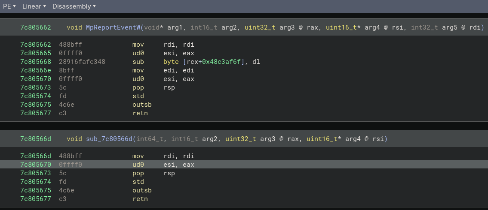
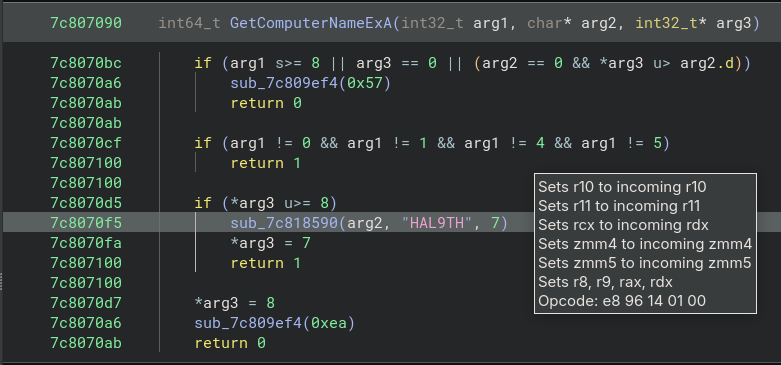
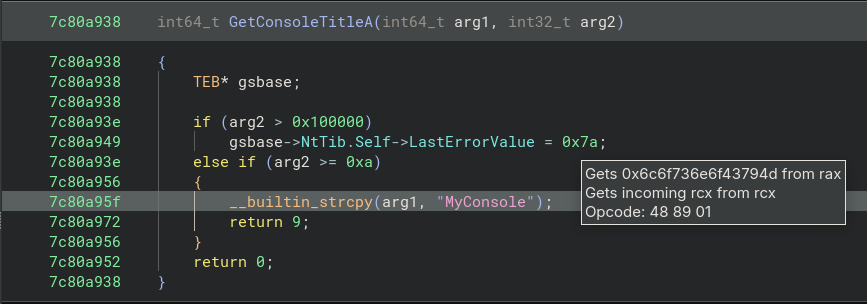

# Reverse Engineering: Windows Defender


## CPU Emulation (`mpengine.dll`)
[Windows Offender: Reverse Engineering Windows Defender's Antivirus Emulator](https://i.blackhat.com/us-18/Thu-August-9/us-18-Bulazel-Windows-Offender-Reverse-Engineering-Windows-Defenders-Antivirus-Emulator.pdf)


### Binwalk Dump of `mpasbase.extracted` (mpasbase.vdm)

```bash
rusty@fedora:binwalk ./mpasbase.extracted
/home/rusty/Downloads/temp/mpasbase.extracted
-------------------------------------------------------
DECIMAL     HEXADECIMAL DESCRIPTION
-------------------------------------------------------
...
105962300   0x650DB3C   Windows PE binary, machine type: Intel x86-64
108544322   0x6784142   Copyright text: "Copyright!"
108544349   0x678415D   Copyright text: "Copyright!nil"
...
109003271   0x67F4207   Windows PE binary, machine type: Intel x86
109702064   0x689EBB0   Windows PE binary, machine type: Intel x86
...
129500820   0x7B80694   Windows PE binary, machine type: Intel x86
129512864   0x7B835A0   SHA256 hash constants, little endian
130688018   0x7CA2412   AES S-Box
130688274   0x7CA2512   AES S-Box
130711658   0x7CA806A   Windows PE binary, machine type: Intel x86
130745770   0x7CB05AA   Windows PE binary, machine type: Intel x86
133795166   0x7F98D5E   Windows PE binary, machine type: Intel x86
...
```

---


### Custom ASM Instruction `apicall` (`0x0F`, `0xFF`, `0xF0`) in `kernel32.dll`



```bash
main(): Scanning ../../bin/harness/MpReportEventW.exe...
EngineScanCallback(): Scanning input
[ODSA 0x0022fe30] [+] GetProcAddress(): MpReportEventW is at 000000007c805662
[ODSA 0x0022fdb0] [+] Pattern found at 000000007c8057aa (+0x148)
```

```bsah
[ODSA 0x0022f830] [INFO] MpEngine DJB2 hash detected: MpReportEvent (PASSIVE)
[ODSA 0x0022f830] [INFO] MpEngine DJB2 hash detected: MpReportEventEx (PASSIVE)
[ODSA 0x0022f830] [INFO] MpEngine DJB2 hash detected: MpReportEventW (PASSIVE)
[ODSA 0x0022f830] [INFO] kernel32 APICALL instruction detected: CopyFileWWorker (PASSIVE)
[ODSA 0x0022f830] [INFO] kernel32 APICALL instruction detected: MoveFileWWorker (PASSIVE)
[ODSA 0x0022fc70] [INFO] ANTI_MP_MODULE [scan_apicall] Score: 5/5 [DETECTED: 1]
```

---


### Embedded String `HAL9TH` in `kernel32.dll!GetComputerNameExA()`

```c
int64_t GetComputerNameExA(int32_t arg1, char* arg2, int32_t* arg3) {
    // ...

    if (*(uint32_t*)arg3 >= 8)
    {
        // &data_7c801438 = HAL9TH
        sub_7c818590(arg2, &data_7c801438, 7);
        *(uint32_t*)arg3 = 7;
        return 1;
    }

    *(uint32_t*)arg3 = 8;
    sub_7c809ef4(0xea);
    return 0;
}
```



```bash
main(): Scanning ../../bin/harness/GetComputerNameA.exe...
EngineScanCallback(): Scanning input
[ODSA 0x0022fd40] [+] GetComputerNameA(): HAL9TH
```

```bash
[ODSA 0x0022f830] [INFO] GetComputerNameA function address: 0x000000007c80a874
[ODSA 0x0022f830] [INFO] GetComputerNameA target address: 0x000000007c80a800
[ODSA 0x0022f830] [INFO] GetComputerNameA string target: HAL9TH
[ODSA 0x0022f830] [INFO] HAL9TH string detected in GetComputerNameA (PASSIVE)
[ODSA 0x0022fc70] [INFO] ANTI_MP_MODULE [scan_HAL9TH] Score: 1/1 [DETECTED: 1]
```

---


### Embedded String `MyConsole` in `kernel32.dll!GetConsoleTitleA()`

```c
int64_t GetConsoleTitleA(int64_t arg1, int32_t arg2)
{
    TEB* gsbase;
    
    if (arg2 > 0x100000)
        gsbase->NtTib.Self->LastErrorValue = 0x7a;
    else if (arg2 >= 0xa)
    {
        __builtin_strcpy(arg1, "MyConsole");
        return 9;
    }
    return 0;
}
```



```bash
main(): Scanning ../../bin/harness/GetConsoleTitleA.exe...
EngineScanCallback(): Scanning input
[ODSA 0x0022fd50] [+] GetConsoleTitleA(): MyConsole
```

```bash
[ODSA 0x0022f830] [INFO] GetConsoleTitleA function address: 0x000000007c80a938
[ODSA 0x0022f830] [INFO] GetConsoleTitleA string target: MyConsole
[ODSA 0x0022f830] [INFO] MyConsole string detected in GetConsoleTitleA (PASSIVE)
[ODSA 0x0022fc70] [INFO] ANTI_MP_MODULE [scan_MyConsole] Score: 1/1 [DETECTED: 1]
```


## References
* Anti-Sandbox
    * [Windows Offender: Reverse Engineering Windows Defender's Antivirus Emulator](https://i.blackhat.com/us-18/Thu-August-9/us-18-Bulazel-Windows-Offender-Reverse-Engineering-Windows-Defenders-Antivirus-Emulator.pdf)
    * [Black Hat USA 2018 - Windows Offender Reverse Engineering Windows Defender's Antivirus Emulator](https://www.youtube.com/watch?v=LvW68czaEGs)
* Defense Evasion
    * [Process Parameter Poisoning: Inside a Novel EDR Evasion Technique](https://flashpoint.io/blog/process-parameter-poisoning-edr-evasion-technique/)
    * [Process Parameter Poisoning by Max Hirschberger](https://sensepost.com/blog/2026/process-parameter-poisoning/)
    * [New 'Defendnot' Tool Exploits Windows to Disable Microsoft Defender](https://csirt.ncc.gov.ng/index.php/resources/security-advisories/309-new-defendnot-tool-exploits-windows-to-disable-microsoft-defender)
    * [New EDR-Freeze technique uses Windows error reporting to disable security tools](https://www.cybersecurity-help.cz/blog/4968.html)
    * [What is Process Injection​​​? Techniques & Preventions](https://www.sentinelone.com/cybersecurity-101/cybersecurity/process-injection/)
    * [Advanced String Obfuscation](https://steve-s.gitbook.io/0xtriboulet/archive/notice/just-malicious/advanced-string-obfuscation)
* Exploits
    * [New Windows Defender zero-day blocks Microsoft antivirus updates](https://www.bleepingcomputer.com/news/security/new-windows-defender-zero-day-blocks-microsoft-antivirus-updates/)
    * [One Patch Behind: Nightmare-Eclipse's ShieldCrash and the Defender Bypass That Won't Stay Fixed](https://www.levelblue.com/blogs/spiderlabs-blog/one-patch-behind-nightmare-eclipses-shieldcrash-and-the-defender-bypass-that-wont-stay-fixed)
    * [CVE-2026-69414 - Microsoft Defender Elevation of Privilege Vulnerability](https://ocve.arawa.fr/cve/CVE-2026-69414)
    * [CVE-2026-55012: Integer Overflow or Wraparound](https://www.rapid7.com/db/vulnerabilities/cve-2026-55012/)
    * [CVE-2026-50656 — Microsoft Defender "RoguePlanet"](https://github.com/0xBlackash/CVE-2026-50656)
    * [CVE-2026-41091 - RedSun](https://github.com/0xBlackash/CVE-2026-41091)
    * [CVE-2026-33825 — “BlueHammer”](https://github.com/0xBlackash/CVE-2026-33825)
* Winbindex
    * [mpengine.dll - Winbindex](https://winbindex.m417z.com/?file=mpengine.dll#61e716826e1af756794e6b59b023b58f6eae9cddff041607d016aba9927ae812)
    * [mprtp.dll - Winbindex](https://winbindex.m417z.com/?file=mprtp.dll#e7fdcd25566a4ac8c8f0460a547b41317d279a6661d9efb726018f4140917084)
    * [wdfilter.sys - Winbindex](https://winbindex.m417z.com/?file=wdfilter.sys#653eb082c2820cee7c7043af89362ed343ce61e9615fc7f0b3ca7ec025d64aba)
* GitHub
    * [taviso/loadlibrary](https://github.com/taviso/loadlibrary)
    * [0xAlexei/WindowsDefenderTools](https://github.com/0xAlexei/WindowsDefenderTools)
    * [HackingLZ/loadlibrary-patch-kit](https://github.com/HackingLZ/loadlibrary-patch-kit)
* Detection
    * [MITRE ATT&CK T1574.001 - DLL Sideloading](https://attack.mitre.org/techniques/T1574/001/)
    * [MITRE ATT&CK T1176.002 - Trusted Application Abuse via VSCode](https://attack.mitre.org/techniques/T1176/002/)
    * [MITRE ATT&CK T1564.010 - Process Parameter Poisoning (P3)](https://attack.mitre.org/techniques/T1564/010/)
    * [MITRE ATT&CK T1055.004 - Early Bird APC Injection](https://attack.mitre.org/techniques/T1055/004/)